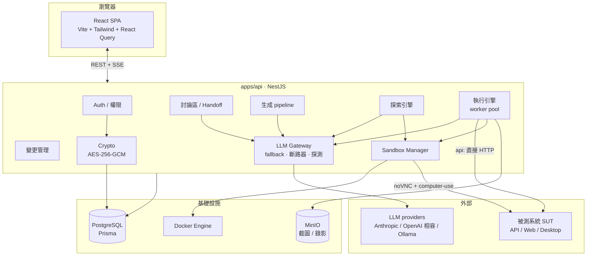

# QA Harness

> **讓 LLM 代替人做 QA 的 web 平台。** 以 Project 為單位管理被測目標（API / Web / Desktop），由 LLM 探索系統、生成測試清單、在真實 sandbox 中親手操作，並留下可查證的證據與判定。

完整的需求與架構規格見 [`qa-harness-spec.md`](./qa-harness-spec.md)。

---

## 目錄

- [這是什麼、為什麼需要它](#這是什麼為什麼需要它)
- [設計理念與目標](#設計理念與目標)
- [能力總覽](#能力總覽)
- [技術架構](#技術架構)
- [資料模型](#資料模型)
- [快速開始](#快速開始)
- [測試](#測試)
- [功能細節](#功能細節)
  - [憑證模型（型別、配對、輪替、顯示）](#憑證模型型別配對輪替顯示)
  - [討論區與 Context Handoff](#討論區與-context-handoff)
  - [測試清單生成 pipeline](#測試清單生成-pipeline)
  - [探索優先模式（Explore-first）](#探索優先模式explore-first)
  - [執行](#執行)
  - [結果頁](#結果頁)
  - [變更管理](#變更管理)
  - [Sandbox 主控台](#sandbox-主控台)
  - [LLM Gateway 與失效復原](#llm-gateway-與失效復原)
- [安全性](#安全性)
- [開發狀態](#開發狀態)
- [授權與貢獻](#授權與貢獻)

---

## 這是什麼、為什麼需要它

用 LLM 開發專案時，**寫程式**的品質已經夠好；卡住的是 **QA**。把「幫我測一下這個系統」丟給一般的 LLM 會遇到四個問題：

1. **不知道要測什麼** —— 沒有系統的全貌，只能亂猜幾條 happy path。
2. **沒有真實環境可操作** —— 它只能「想像」點擊，不能真的點、真的送 request、真的看到畫面。
3. **判定結果不可信** —— 「看起來沒問題」不等於驗到了，容易給出過度樂觀的結論。
4. **沒有留下證據** —— 出了事無法回溯是哪一步、看到什麼才這樣判。

**QA Harness 把這四件事做成一個平台。** 它讓一個 LLM 代理：先探索被測系統理解全局 → 生成分功能、分優先級、涵蓋 happy / edge / negative 的測試清單 → 在 Linux 桌面 sandbox 裡用 computer-use（或對 API 直接送 HTTP）**實際執行** → 由另一次「判定」呼叫依完整過程給出 pass / fail / blocked，fail 必附重現步驟 → 每一步都存截圖、錄影、HTTP log 作為證據。人只需要在對話裡把系統講清楚、覆核結果、決定要不要接受它提出的變更。

**適合誰**：用 AI 高速開發、但苦於 QA 跟不上的小團隊；需要對 Web / API / 桌面應用做可重複、有紀錄的探索式測試的人。

**第一版刻意不做**：iOS/Android 模擬器、CI/PR 觸發、email/Slack 通知、只測 dev 環境的操作安全圍籬（見 spec §1.2）。

---

## 設計理念與目標

這些原則貫穿整個程式碼，也是這個專案想證明的事：

| 原則 | 怎麼落實 |
|---|---|
| **憑證絕不進入 prompt** | 模型只看得到憑證的**名稱與說明**，要用時寫 `{{名稱}}`，伺服器在送出前才代入真值；存下來的紀錄一律遮蔽。實測資料庫零外洩。 |
| **LLM 只提案，不擅自改動** | 測試清單的增刪、描述的更新，LLM 都只產生「變更提案」，未經人逐項接受、套用前，對現有資料零影響。 |
| **判定要有證據** | verdict 是獨立的一次呼叫，只看完整執行過程 + 最後幾張畫面；`pass` 需要真的驗到，`fail` 強制寫重現步驟，`blocked` 誠實承認「沒能執行完」而不硬給結論。 |
| **報告要誠實** | 結果頁記錄實際用了哪幾組 LLM 設定、各打幾次、每次 fallback 切換的原因與時間。悄悄用第三組設定跑完的執行，不該看起來跟一路順利的一樣。 |
| **探索全程唯讀** | 探索與深入盤點階段用黑名單擋掉 delete / logout / submit / 付款，甚至在唯讀階段根本不給模型 click 動作 —— 從設計上關掉破壞性操作的風險。 |
| **能確定性算出的，就不花模型** | 探索用 CDP 直接讀渲染後的 DOM 來列舉連結、表單、控制項；模型的預算留給「判斷」，不浪費在「辨識」。 |
| **不宣稱窮盡** | UI 顯示的是可回報的**覆蓋率**（掃了幾條路由、幾個身份、產生幾條案例），不是「全面測完」這種做不到的承諾。 |
| **省 token** | 前置流程與探索走確定性路徑；系統整個掛掉時代理可以直接中止整趟（見 [abort_run](#執行)），不對死掉的系統一條條白測。 |
| **長流程不因單一模型故障而中斷** | LLM Gateway 有 fallback chain + 斷路器 + 背景探測；所有設定都不可用時流程**暫停保留進度**，模型恢復後自動續跑。 |

---

## 能力總覽

- **多人協作**：Team → Project → Target 三層階層，Project 與 Target 各有 `owner / editor / viewer` 兩層權限。
- **引導式討論區**：LLM 帶著「必須釐清的項目」清單主動提問，整理出 Project / Target 的描述，並在被測面清楚後**提案**建立 Target。
- **Context Handoff**：產生交接 prompt 給 coding agent，把回傳的系統描述文件解析匯入。
- **測試清單生成**：讀 OpenAPI / 抓首頁 / 探索結果 → 功能清單 → 逐功能展開案例 → 去重排序。
- **探索優先模式**：不寫任何腳本，只宣告「有哪幾種使用者」，模型開 sandbox 走一遍、產出權限矩陣與落地案例。
- **兩種執行器**：`api` 直接送 HTTP；`web` / `desktop` 起容器用 computer-use 操作，可上限並行。
- **即時執行畫面**：noVNC 串流 + SSE 進度（階段、Finding、可即時編輯 / 跳過 / 加案例 / 中止）。
- **結果與證據**：pass/fail/blocked 統計、逐案例判定與重現步驟、步驟時間軸、截圖、錄影、HTTP log、人工覆核。
- **變更管理**：功能增減 → 變更提案 → 逐項接受 → 套用 → 版本時間軸。
- **憑證管理**：型別化（帳號密碼 / API key / …）、配對登入、AES-256-GCM 加密、可輪替、owner 可顯示。
- **Admin 後台**：使用者管理、LLM provider 設定與 fallback 排序、sandbox 資源與並行設定、稽核紀錄。

---

## 技術架構

**Monorepo**（npm workspaces）。TypeScript 全端。

```
schemas/                 LLM 輸出的 JSON schema（單一事實來源，§4.9）
packages/schemas/        @qa-harness/schemas：schema 匯出、Ajv 驗證、寬鬆 JSON 解析
apps/api/                NestJS 11 API（REST + SSE；Prisma 6 + PostgreSQL）
apps/web/                React 19 + Vite 6 + Tailwind 4 + React Query 前端
docker/sandbox/          Sandbox 桌面容器 image（Xvfb + Chromium + computer-use agent）
docker-compose.yml       postgres(5433) / redis(6380) / minio(9000, 9001)
```

### 技術選型
- **後端**：NestJS 11、Prisma 6（PostgreSQL）、passport（Google / GitHub OAuth）、AES-256-GCM 加密憑證、SSE 推播即時進度。
- **前端**：React 19、Vite 6、Tailwind CSS v4（class-based 深色模式）、TanStack Query、React Router。
- **LLM**：自訂 Gateway，支援 Anthropic / OpenAI 相容 / Ollama；所有輸出走 JSON schema（native structured output + prompt 雙保險）+ Ajv 後端驗證 + 重試 / fallback / 斷路器。
- **Sandbox**：直接呼叫 Docker Engine API 的 unix socket（不裝額外 SDK）；容器內 Xvfb + openbox + x11vnc + noVNC + Chromium + 一支純標準函式庫的 `agent.py`（computer-use 動作 API）。
- **物件儲存**：MinIO（S3 相容），存截圖與錄影。

### 系統結構圖



### 核心子系統

- **Output Contract（`schemas/` + `@qa-harness/schemas`）**：每一種 LLM 輸出（討論輪次、功能清單、測試案例、變更提案、執行步驟、判定、finding、handoff、探索筆記）都有一份 JSON schema，是**單一事實來源**。Gateway 送出時同時用 native structured output 與 prompt，回來以 Ajv 驗證，失敗把錯誤餵回模型重試。
- **LLM Gateway**：`structured(purpose, schemaName, request)` —— 依用途取 fallback chain（`execute` 只用支援 vision 的設定），逐一嘗試 provider，timeout / rate-limit / 5xx / 拒答 / 重試用盡就換下一個；每次嘗試寫 `llm_call_logs`。含斷路器與背景探測復原（見下）。
- **執行引擎**：一個 Target 同時只有一個 run（條件式 UPDATE 搶鎖）。`api` 類型用 worker pool 上限並行；`web` / `desktop` 共用一個 sandbox 序列執行。每步截圖存 MinIO。
- **探索引擎**：sandbox 內 Chromium 開遠端除錯埠，agent 用純標準函式庫的 CDP client 讀真實 DOM，做確定性爬取 + 逐身份權限矩陣 + RWD 掃描 + 互動探測 + 案例合成。
- **Sandbox Manager**：走 Docker Engine API，負責建立 / 健康檢查 / ephemeral port / TTL 回收 / 資源與並行上限。

---

## 資料模型

```
Team
└── Project（描述、參考資料、成員、討論串）
    └── QA Target（種類 api/web/desktop、設定、憑證、身份、成員 override）
        ├── Feature ×N
        │   └── Test Case ×N（每次編輯產生一個版本）
        ├── ApiSetup / FeatureSetup（不經 LLM 的前置流程，擷取 token 等）
        ├── TargetIdentity ×N（角色 + 登入用的憑證引用，供探索用）
        ├── TargetCredential ×N（型別化、加密）
        ├── ExplorationRun ×N
        └── TestRun ×N
            ├── RunCaseQueue（本次要跑哪些案例）
            ├── RunStep（逐步過程）
            ├── TestResult（判定 + 證據 + 人工覆核）
            └── RunFinding（過程中的額外發現）
```

**權限規則**（避免衝突，spec §2.3）：Project 成員預設在所有 Target 取得相同角色；Target 層只能**提升**不能降低；Project owner 恆為所有 Target 的 owner；有效角色 = `max(project_role, target_role_override)`。

**登入統一**：所有人走同一套登入（Google / GitHub OAuth，或開發用 dev-login）。`ADMIN_EMAIL` 的帳號登入後直接進 `/admin` —— admin 是使用者身分上的一個角色，**沒有獨立密碼體系**。

---

## 快速開始

需求：Node ≥ 20、Docker。

```bash
cp .env.example .env            # 填 CREDENTIAL_MASTER_KEY: openssl rand -base64 32
npm install
npm run infra:up                # 起 postgres / redis / minio
npm run build -w packages/schemas
npm run db:migrate              # prisma migrate（apps/api）
npm run db:seed                 # 把 ADMIN_EMAIL 的使用者標記為 admin
docker build -t qa-harness-sandbox:0.5 docker/sandbox   # sandbox 桌面 image（web/desktop 執行與探索需要）
npm run dev:api                 # http://localhost:3001/api
npm run dev:web                 # http://localhost:5173
```

- **登入**：Google / GitHub OAuth（設定 `GOOGLE_*` / `GITHUB_*`），或 `DEV_LOGIN_ENABLED=true` 時用 email 直接登入。
- **加密**：API key 與 Target 憑證以 AES-256-GCM 加密（`CREDENTIAL_MASTER_KEY`，32 bytes base64）。**這把 key 沒填就起不來**，也不要 commit。
- **sandbox image tag** 可在 Admin → Sandbox 調整；預設 `qa-harness-sandbox:0.5`。

---

## 測試

```bash
npm test -w packages/schemas    # schema 驗證
npm test -w apps/api            # 單元：權限規則、加密、gateway 重試/fallback、憑證/輪替等
npm run test:e2e -w apps/api    # e2e：auth、CRUD、權限、admin LLM、執行、憑證、探索…（需 docker db）
```

e2e 用真實的 Nest app + PostgreSQL + 假的 LLM adapter 驅動，涵蓋執行流程、憑證輪替與同步、型別化憑證、探索等關鍵路徑。

---

## 功能細節

### 憑證模型（型別、配對、輪替、顯示）

被測系統的登入資訊是 Target 的一級公民，設計上讓**模型能靠語意選對憑證、又永遠碰不到真值**。

- **型別化**：新增憑證時先選型別 —— `帳號密碼` / `API key` / `Bearer token` / `Cookie` / `其他`。
- **配對登入**：`帳號密碼` 型別是一組綁定的登入（帳號 + 密碼共用一個名稱與說明），引用時寫 `{{名稱.username}}` / `{{名稱.password}}`；其他型別是單一秘密，寫 `{{名稱}}`。
- **說明進 prompt**：每筆憑證的**說明**會放進給模型的 prompt。這樣模型看到的是「『一般使用者』（帳號密碼）：一般會員，登入後看 Browse」與「『管理員』（帳號密碼）：平台管理員，登入後進 /admin」，就會依 case 需要的身份挑對的那一個 —— 而不是看到 `login` / `password` 這種扁平清單、憑名字猜、結果一直抓到 admin。
- **加密與最小暴露**：值一律 AES-256-GCM 加密，**永不進 prompt、永不出現在列表或執行紀錄**。唯一的例外是 owner 在編輯時可以按「顯示目前值」把帳密以明文帶出（owner-only、每次都寫 audit log）。
- **身份（TargetIdentity）**：一個角色 + 它登入用的憑證引用（探索用）。改名憑證會自動改寫 setup 流程、身份的 `credentialKeys` 與 `loginConfig` 裡的引用；刪除憑證會清掉身份裡的懸空引用。
- **輪替（rotation）**：測試本身會改變系統狀態，而憑證是狀態的一部分 —— admin 在測試裡改掉了某個 user 的密碼，存的憑證若不跟著改，下一趟登入就會失敗。把憑證標記為**可輪替**後：case 要改它的值時用 `rotate_credential` 動作，平台**產生一組強隨機新值**（模型看不到、也不用自己編）並以 `{{名稱.password__next}}` 代入；改動確實生效後（`api` 以請求回 2xx 為準並可用新值重新登入驗證；`web` 以該 case 判定 pass 為準），平台**自動把儲存的憑證同步成新值**。整個過程新值一樣被遮蔽、不外洩。

### 討論區與 Context Handoff（§4.1 / §4.2）

**討論區**：Project 與 Target 各一條討論串。LLM 帶著 scope 對應的「必須釐清項目」清單主動提問，每輪最多 3 題，每題標註它要釐清哪一項；回覆同時更新完整度（未知 / 部分 / 清楚）與描述草稿。使用者訊息中的連結會自動抓取，內容送進 context 並存為 `project_attachments`。被測面清楚後 LLM 會提出 Target 提案卡，**只提案不建立**，由 Project owner 接受後才真的建立 Target。一鍵「儲存為描述」產生新的 description version（`source=discussion`）。

**Context Handoff**：依 scope 與 target kind 產生交接 prompt → 貼給 coding agent → 把回傳的 Markdown 貼回來 → 預覽解析結果 → 選擇覆蓋 / 合併 / 當作附件套用。解析採寬鬆策略：認得的 section 結構化匯入，未知 section 原樣保留，完全無法解析則強制走附件。交接 prompt 會要求對方**先描述系統在做什麼、有哪些角色**，再據此設計測試。偵測到疑似憑證時會標示行號與遮罩預覽，並**從寫入的描述中移除**，原始文件另存於 `handoff_documents`。

### 測試清單生成 pipeline（§4.3）

Target 頁的「測試清單」分頁可以一鍵生成，過程以 SSE 串到前端。

1. **現況探索**：api 類型讀 `openapi_url` 或貼上的 schema，抽出每個 endpoint；web 類型抓首頁抽標題階層、連結與表單欄位；desktop 目前依描述生成。
2. **功能清單**：描述 + 設定 + 探索結果 + 討論區附件 + 交接文件建議案例一起送進 `feature_list` schema。
3. **逐功能展開**：每個功能各一次呼叫，要求覆蓋 happy / edge / negative 與 P0–P3。
4. **去重與排序**：用「標題 + 預期結果」的字元 bigram 相似度（門檻 0.75）去掉改寫重複，再依功能、優先級、類型排序。刻意偏向保留 —— 多留一條使用者按一下就刪掉，誤刪一條是靜默的覆蓋缺口。
5. **寫入**：`features` 與 `test_cases`，每條案例同時建立第 1 版。`replace` 只清掉先前生成的案例，手寫的一律保留。

### 探索優先模式（Explore-first）

給前端 QA 用：使用者不寫任何測試腳本，只宣告「有哪幾種使用者」，剩下交給模型 —— 它開一個 sandbox 把系統實際走一遍，理解全局之後才設計案例。

**關鍵決定：讓 sandbox 看得到真正的 DOM。** 容器裡的 Chromium 開了 `--remote-debugging-port`，agent 用一個純標準函式庫的 CDP WebSocket client 連上去，連結、表單欄位、控制項都是從「渲染後的頁面」讀出來的，不是從截圖用猜的。

**五個階段**

1. **確定性爬取**：CDP 讀 DOM → BFS 走訪。路由正規化把 `/todos/1`、`/todos/2` 收斂成 `/todos/:id`。每頁存 DOM 探針、截圖、連結邊。
2. **逐身份 + 權限矩陣**：每個身份一一登入各爬一遍，並**主動跨身份探測**每條路由 —— 「誰能看到什麼」是比對出來的，不是猜的。一條該受保護的路由被低權限身份進入了就標成可疑。
3. **RWD 斷點掃描**：各斷點 resize + 截圖，用 DOM 指標（橫向溢出等）先篩。
4. **互動探測**：每頁點開「開啟型」控制項，用 DOM diff 偵測 modal / drawer / 選單，記成子狀態節點。**全程唯讀**：只打開、記欄位，絕不送出；黑名單擋掉會改狀態的按鈕；點完一定回到原狀態。
5. **從地圖設計案例 + 有預算的深入盤點**：對每個實際存在的頁面各發一次小的合成呼叫（含專門處理跨身份越權的呼叫），案例直接進測試清單；有表單的頁面再用視覺深入盤點（此階段**不給模型 click 動作**，從設計上關掉破壞風險）。

**安全與正確性**：全程唯讀；`/logout` 之類會改狀態的連結預設不跟；關掉 Chromium 密碼管理員（否則「Save password?」彈窗汙染截圖）；身份之間清 cookie 與 storage（否則管理員 session 漏進訪客爬取、權限矩陣就是一場謊言）。

> 實測：拿 StreamHub（React SPA，USER/ADMIN 雙 portal）零人工規劃 → 掃出多條路由、正確的三身份權限矩陣（`/admin/*` 只有 admin 進得去）、視覺深入抓到「帳號表單用 GET 傳密碼欄位」這個真實安全問題，並產出數十條落地案例（含專門的越權存取案例）。

### 執行（§4.5 / §4.6）

按「開始執行」後，run 在背景跑，關掉瀏覽器不會中斷。

- **一個 Target 同時只有一個 run**：條件式 UPDATE 搶鎖（`status = idle` 才搶得到），不排隊也不接手。結束一定釋放鎖並回收 sandbox。
- **兩種執行器**：`api` 不起 sandbox，直接送 HTTP（可上限並行，預設 4，`concurrency=1` 即序列）；`web` / `desktop` 起容器用 computer use 操作，共用一個 sandbox 序列執行。每步截圖存 MinIO。
- **憑證不進 prompt**：模型只看得到憑證的名稱與說明，要用時寫 `{{名稱}}` / `{{名稱.username}}`，伺服器送出前才代入真值；紀錄裡憑證值一律遮蔽。詳見[憑證模型](#憑證模型型別配對輪替顯示)。
- **主機位址自動轉換**：容器裡的 `localhost` 是容器自己；設定寫 `localhost` 的被測站台會自動轉成 `host.docker.internal` 並在 prompt 裡告訴模型。
- **Finding 與 verdict 分開**：模型執行中發現與本條案例無關的問題時用 `report_finding` 記下就繼續；判定是另一次呼叫，只看完整過程，fail 時強制寫重現步驟。
- **逐案例鎖定**：排隊中的案例可改（本次 run 用新版本），正在跑的鎖住，跑完的可改但結果標記「已於執行後修改」。執行中還能跳過 / 加案例 / 中止。
- **系統掛掉可中止整趟（`abort_run`）**：如果代理發現**整個被測系統根本連不上／沒啟動**（連線一直被拒、整站連線層級錯誤），再一條條測只是浪費 token，它可以送 `abort_run` 中止整趟 —— 剩餘案例標為 skipped、run 收尾為 failed 並記一條 critical finding。**嚴格限定**只用於整體性掛掉：單一頁面 404、單一 API 500、某功能壞掉都不算，那些走 `report_finding` 或 `done`。
- **LLM 掛掉不中斷**：走暫停機制保留進度，模型恢復後從中斷那一步繼續。

### 結果頁（§4.7）

Target 頁「執行」分頁下半部即結果頁，選一次執行來看。

- **總覽**：pass / fail / blocked / skipped、耗時、步數，以及「使用的 model」—— 含這次實際用了哪幾組設定、各打幾次、失敗幾次、每次 fallback 切換的時間與原因。
- **依 feature 的通過率**、**每條 case 的判定與理由、重現步驟、步驟時間軸、錄影、HTTP log（憑證已遮蔽）**。
- **人工覆核**：`human_verdict` 和模型判定並排、不覆蓋，不一致時明確標示。
- **一鍵重跑失敗案例**；判定為 `possibly_changed` 的失敗會浮出「建立變更提案」；**Finding** 可轉成變更提案、或轉成測試案例、或標記忽略。

**錄影**：sandbox 內用 ffmpeg 抓 X display（5 fps、x264 ultrafast），一條 case 一段、判定前就停；停止用 SIGINT（否則 mp4 缺 moov atom 播不出來）。錄影失敗只會少一段影片，可在 Admin → Sandbox 關掉。**保留期到了**會刪截圖與錄影並清掉 `test_results.evidence` 裡的 key，逐字過程與判定留著。

### 變更管理（§4.4）

開發是動態的，功能會增減。原則：**LLM 只提出提案、不直接改 test list**，提案未套用前對現有資料零影響。四個入口（討論區 / 手動改描述 / 執行偵測 `possibly_changed` / Finding）匯進同一條流程。

- **兩段式分析**：先要 `change_proposal`（哪些功能與案例受影響、為什麼、新描述，不寫案例內容），再對要新增／修改的案例逐條補內容（一輪最多 15 條）—— 避免一次輸出過長撞上 LLM proxy 的逾時。
- **逐項決定**：每個變動項目存檔時就有穩定 id，勾選針對 id；`before` 一律從資料庫讀、diff 由伺服器算 —— 給人看的差異就是實際會套用的那一份。修改型變動一定顯示 diff，可套用前手動改。
- **套用**：寫新的 `description_version`、更新 features 與 test cases（每條產生新版本、用 `change_id` 指回）、寫 `change_log`；被移除的功能其案例標為 `deprecated` 而非刪除；沒勾的項目也記為 rejected。Target 執行中可建立提案但不能套用。

### Sandbox 主控台（§4.8 / §5.1）

Admin → Sandbox → 主控台可直接起容器、看畫面、下指令給 LLM 操作。

- **容器 image**（`docker/sandbox/`）：Debian + Xvfb + openbox + x11vnc + noVNC + Chromium + 一支純標準函式庫的 computer-use agent（`agent.py`），對外開 6080（noVNC）與 8000（動作 API）。動作集合即 `execution_step` schema 的 action。
- **Sandbox Manager**：走 Docker Engine API 的 unix socket，負責建立、健康檢查、ephemeral port、TTL 回收、CPU/記憶體/解析度/並行上限。
- **即時畫面**：容器內建 noVNC，瀏覽器直接連 `127.0.0.1:<port>`（只綁 loopback）。
- **與 LLM 對話**：每個 sandbox 一條常駐對話，agent loop「截圖 → 問 vision model 下一步 → 執行 → 回饋」直到 `done` 或步數上限；執行中可插話、對話會延續，進度以 SSE 串出。這個迴圈就是執行引擎的核心。

### LLM Gateway 與失效復原

`LlmGatewayService.structured(purpose, schemaName, request)`：

1. 依用途取 fallback chain（admin 可拖曳排序；`execute` 只用支援 vision 的設定）。
2. 呼叫 provider（anthropic / openai 相容 / ollama），schema 同時走 native structured output 與 prompt。
3. 後端以 Ajv 驗證，失敗把錯誤餵回模型重試（預設 2 次）。
4. timeout / rate limit / 5xx / 拒答 / 重試用盡 → 下一個 config。
5. 每次嘗試寫入 `llm_call_logs`（模型、耗時、token、原始輸出）。

**斷路器 + 探測**：連續 3 次失敗的設定標記 `down`、選鏈時跳過；背景迴圈每 15 秒（`LLM_PROBE_TICK_MS` 可調）對 `down` 的設定送極短 prompt 探測，退避 30 秒倍增到上限 5 分鐘，但迴圈永不停、不放棄任何設定。**所有設定都不可用時**，生成 pipeline 與 sandbox 對話進入 `paused` 保留進度，任一設定恢復就自動續跑（生成 run 甚至在 API 重啟後也能從 `generation_runs.progress` 續跑）。互動式請求（討論區）不暫停，直接回 503 說明原因。

---

## 安全性

- **憑證加密**：AES-256-GCM，master key 走環境變數 `CREDENTIAL_MASTER_KEY`，`.env` 不進版控。
- **憑證不外洩**：不進 prompt、不進列表、執行紀錄遮蔽；唯一明文出口是 owner 主動「顯示目前值」，且寫 audit。
- **SSRF / 注入防護**：對外請求前檢查、封鎖內網位址；憑證代入只限 Target 自身 origin；外部內容（網頁、MCP 回傳、HTTP response body）以「不可信資料」標記包裹再送進 prompt。
- **探索唯讀**：黑名單擋破壞性操作，深入盤點階段根本不給 click。
- **稽核**：關鍵動作（登入、憑證設定 / 輪替 / 顯示、執行、變更套用）寫 `audit_logs`。

---

## 開發狀態

規格 §7 的開發順序：

| 步驟 | 狀態 |
|---|---|
| 1. Auth + Team / Project / Target CRUD + 權限規則（含測試） | ✅ |
| 2. Admin 後台：LLM provider 設定 + 測試 + fallback；LLM Gateway | ✅ |
| 3. Output Contract：所有 schema + 驗證 / 重試 / fallback（含斷路器、探測復原、暫停續跑） | ✅ |
| 4. 討論區（引導式對談 + 完整度面板 + Target 提案）+ Context Handoff | ✅ |
| 5. Test case 生成 pipeline + features 結構 | ✅ |
| 6. 變更管理（提案 → 逐項接受 → 套用 → 時間軸） | ✅ |
| 7. Sandbox Manager + 容器 image + noVNC 串流 | ✅ |
| 8. Agent Worker + web/desktop 執行 + 執行中頁面 | ✅ |
| 9. 結果頁 + 人工覆核 + 被動偵測 + Finding 轉換 | ✅ |
| 10. desktop、skills / MCP、用量、增量 Handoff | ✅ |
| 探索優先模式（Explore-first） | ✅ |
| 憑證型別化 / 配對 / 輪替 / 顯示、`abort_run`、API target 上限並行 | ✅ |

---

## 授權與貢獻

以 [MIT License](./LICENSE) 授權。歡迎 issue / PR，送 PR 前請確認 `npm test` 與 `npm run test:e2e -w apps/api` 通過。
