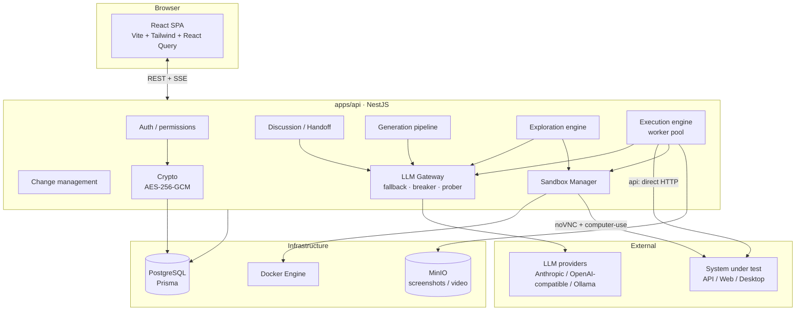

# QA Harness

> **A web platform where an LLM does QA instead of a human.** You manage targets (API / Web / Desktop) per project; an LLM agent explores the system, generates a test list, actually operates it in a real sandbox, and leaves behind verifiable evidence and verdicts.

The full requirements and architecture spec is in [`qa-harness-spec.md`](./qa-harness-spec.md).

---

## Table of contents

- [What it is and why](#what-it-is-and-why)
- [Design principles and goals](#design-principles-and-goals)
- [Capabilities at a glance](#capabilities-at-a-glance)
- [Technical architecture](#technical-architecture)
- [Data model](#data-model)
- [Getting started](#getting-started)
- [Testing](#testing)
- [Feature details](#feature-details)
  - [Credential model (typed, paired, rotation, reveal)](#credential-model-typed-paired-rotation-reveal)
  - [Discussion and Context Handoff](#discussion-and-context-handoff)
  - [Test-list generation pipeline](#test-list-generation-pipeline)
  - [Explore-first mode](#explore-first-mode)
  - [Execution](#execution)
  - [Results](#results)
  - [Change management](#change-management)
  - [Sandbox console](#sandbox-console)
  - [LLM Gateway and failure recovery](#llm-gateway-and-failure-recovery)
- [Security](#security)
- [Development status](#development-status)
- [License and contributing](#license-and-contributing)

---

## What it is and why

When you build software with an LLM, the **coding** is already good enough; the part that lags is **QA**. Handing "test this system for me" to a general-purpose LLM hits four problems:

1. **It doesn't know what to test** — with no view of the whole system, it guesses a few happy paths.
2. **It has no real environment to operate** — it can only *imagine* clicking, not actually click, send a request, or see the screen.
3. **Its verdicts aren't trustworthy** — "looks fine" isn't the same as verified; it tends toward over-optimistic conclusions.
4. **It leaves no evidence** — when something breaks you can't trace which step it was or what it saw.

**QA Harness turns those four things into a platform.** An LLM agent: explores the target to understand the whole picture → generates a test list organized by feature and priority, covering happy / edge / negative → **actually executes** it in a Linux desktop sandbox with computer-use (or sends HTTP directly for an API) → a separate *judgment* call produces pass / fail / blocked from the full run, with repro steps mandatory on a fail → every step is stored as screenshots, recordings, and HTTP logs. A human only needs to describe the system in a conversation, review results, and decide whether to accept the changes the agent proposes.

**Who it's for**: small teams shipping fast with AI whose QA can't keep up; anyone who needs repeatable, evidence-backed exploratory testing of a Web / API / desktop app.

**Deliberately out of scope for v1**: iOS/Android emulators, CI/PR triggers, email/Slack notifications, and operational safety rails for testing prod (see spec §1.2).

---

## Design principles and goals

These run through the whole codebase and are what the project sets out to prove:

| Principle | How it's enforced |
|---|---|
| **Credentials never enter a prompt** | The model only ever sees a credential's **name and description**; it writes `{{name}}` and the server substitutes the real value just before sending. Stored transcripts mask values. Verified zero leakage in the database. |
| **The LLM proposes, it doesn't change things** | Additions/removals to the test list and updates to the description are all produced as *change proposals*; until a human accepts them item by item and applies them, existing data is untouched. |
| **Verdicts need evidence** | The verdict is a separate call that sees only the full run plus the last few frames; `pass` requires real verification, `fail` forces repro steps, `blocked` honestly admits "couldn't finish" rather than forcing a conclusion. |
| **Reports are honest** | The results page records which LLM configs actually served the run, how many calls each took, and every fallback switch with its reason and time. A run that quietly finished on the third config shouldn't look identical to one that never faltered. |
| **Exploration is read-only** | The explore and deep-dive stages blacklist delete / logout / submit / payment, and the read-only stage doesn't even give the model a click action — designing away the risk of destructive operations. |
| **Compute what you can; don't spend the model on it** | Exploration reads the rendered DOM over CDP to enumerate links, forms, and controls; the model's budget goes to *judgment*, not *recognition*. |
| **Never claim exhaustiveness** | The UI reports **coverage** you can point to (routes scanned, identities, cases produced), not "fully tested" — a promise it can't keep. |
| **Save tokens** | Setup flows and exploration take deterministic paths; when the whole system is down, the agent can stop the entire run (see [abort_run](#execution)) instead of testing a dead system case by case. |
| **A long flow survives a single model failure** | The LLM Gateway has a fallback chain + circuit breaker + background prober; when every config is unusable the flow **pauses with its progress kept** and resumes on its own once a model recovers. |

---

## Capabilities at a glance

- **Multi-user collaboration**: a Team → Project → Target hierarchy, with `owner / editor / viewer` at both the project and target level.
- **Guided discussion**: the LLM asks proactively from a checklist of "things that must be clarified", builds up the project/target description, and **proposes** creating a target once the surface is clear.
- **Context Handoff**: produce a handoff prompt for a coding agent, then import the returned system description.
- **Test-list generation**: read OpenAPI / fetch the home page / use explore results → feature list → expand cases per feature → dedupe and sort.
- **Explore-first mode**: write no scripts, just declare "which kinds of user exist"; the model opens a sandbox, walks the system, and produces a permission matrix and landed cases.
- **Two executors**: `api` sends HTTP directly; `web` / `desktop` drive a container via computer-use, with bounded parallelism.
- **Live execution view**: noVNC stream + SSE progress (phases, findings, edit / skip / add cases / abort in place).
- **Results and evidence**: pass/fail/blocked stats, per-case verdicts and repro steps, a step timeline, screenshots, recordings, HTTP logs, and human review.
- **Change management**: features added/removed → change proposal → item-by-item acceptance → apply → versioned timeline.
- **Credential management**: typed (username/password, API key, …), paired logins, AES-256-GCM encryption, rotatable, owner-revealable.
- **Admin console**: user management, LLM provider config and fallback ordering, sandbox resource/concurrency settings, audit log.

---

## Technical architecture

A **monorepo** (npm workspaces). TypeScript end to end.

```
schemas/                 JSON schemas for LLM output (single source of truth, §4.9)
packages/schemas/        @qa-harness/schemas: schema exports, Ajv validation, lenient JSON parsing
apps/api/                NestJS 11 API (REST + SSE; Prisma 6 + PostgreSQL)
apps/web/                React 19 + Vite 6 + Tailwind 4 + React Query frontend
docker/sandbox/          Sandbox desktop container image (Xvfb + Chromium + computer-use agent)
docker-compose.yml       postgres(5433) / redis(6380) / minio(9000, 9001)
```

### Stack
- **Backend**: NestJS 11, Prisma 6 (PostgreSQL), passport (Google / GitHub OAuth), AES-256-GCM credential encryption, SSE for live progress.
- **Frontend**: React 19, Vite 6, Tailwind CSS v4 (class-based dark mode), TanStack Query, React Router.
- **LLM**: a custom gateway supporting Anthropic / OpenAI-compatible / Ollama; all output goes through JSON schema (native structured output + prompt) with Ajv server-side validation + retry / fallback / circuit breaker.
- **Sandbox**: talks to the Docker Engine API over its unix socket (no extra SDK); the container runs Xvfb + openbox + x11vnc + noVNC + Chromium plus a stdlib-only `agent.py` (a computer-use action API).
- **Object storage**: MinIO (S3-compatible), for screenshots and recordings.

### System diagram



### Core subsystems

- **Output Contract (`schemas/` + `@qa-harness/schemas`)**: every kind of LLM output (discussion turn, feature list, test case, change proposal, execution step, verdict, finding, handoff, exploration notes) has a JSON schema that is the **single source of truth**. The gateway sends it as both native structured output and prompt, validates the reply with Ajv, and feeds errors back to the model to retry.
- **LLM Gateway**: `structured(purpose, schemaName, request)` — picks the fallback chain for the purpose (`execute` only uses vision-capable configs), tries providers in turn, moves on for timeout / rate-limit / 5xx / refusal / retries exhausted, and logs every attempt to `llm_call_logs`. Includes the breaker and background prober (below).
- **Execution engine**: one run per target at a time (a conditional UPDATE grabs the lock). `api` targets run a bounded parallel worker pool; `web` / `desktop` run a small pool of sandboxes, one per worker. Each step's screenshot goes to MinIO.
- **Exploration engine**: Chromium in the sandbox opens a remote debugging port; the agent reads the real DOM with a stdlib CDP client and does deterministic crawling + per-identity permission matrix + RWD scan + interaction probing + case synthesis.
- **Sandbox Manager**: uses the Docker Engine API to create / health-check / allocate ephemeral ports / reclaim on TTL, with resource and concurrency caps.

---

## Data model

```
Team
└── Project (description, references, members, discussion)
    └── QA Target (kind api/web/desktop, config, credentials, identities, member overrides)
        ├── Feature ×N
        │   └── Test Case ×N (each edit creates a version)
        ├── ApiSetup / FeatureSetup (setup flows that run without the LLM, capturing tokens etc.)
        ├── TargetIdentity ×N (a role + the credentials it logs in with, for exploration)
        ├── TargetCredential ×N (typed, encrypted)
        ├── ExplorationRun ×N
        └── TestRun ×N
            ├── RunCaseQueue (which cases this run covers)
            ├── RunStep (the step-by-step process)
            ├── TestResult (verdict + evidence + human review)
            └── RunFinding (incidental findings during the run)
```

**Permission rules** (to avoid conflicts, spec §2.3): a project member gets the same role by default on every target; a target may only **raise** it, never lower it; the project owner is always owner of every target; effective role = `max(project_role, target_role_override)`.

**Unified login**: everyone uses the same login (Google / GitHub OAuth, or a dev-login for development). The `ADMIN_EMAIL` account lands on `/admin` after logging in — admin is a role on a user, with **no separate password system**.

---

## Getting started

Requirements: Node ≥ 20, Docker.

```bash
cp .env.example .env            # set CREDENTIAL_MASTER_KEY: openssl rand -base64 32
npm install
npm run infra:up                # start postgres / redis / minio
npm run build -w packages/schemas
npm run db:migrate              # prisma migrate (apps/api)
npm run db:seed                 # mark the ADMIN_EMAIL user as admin
docker build -t qa-harness-sandbox:0.5 docker/sandbox   # sandbox desktop image (needed for web/desktop runs and exploration)
npm run dev:api                 # http://localhost:3001/api
npm run dev:web                 # http://localhost:5173
```

- **Login**: Google / GitHub OAuth (set `GOOGLE_*` / `GITHUB_*`), or email-only login when `DEV_LOGIN_ENABLED=true`.
- **Encryption**: API keys and target credentials are AES-256-GCM encrypted (`CREDENTIAL_MASTER_KEY`, 32 bytes base64). **The app won't start without this key** — and don't commit it.
- The **sandbox image tag** is configurable under Admin → Sandbox; the default is `qa-harness-sandbox:0.5`.

---

## Testing

```bash
npm test -w packages/schemas    # schema validation
npm test -w apps/api            # unit: permission rules, encryption, gateway retry/fallback, credentials/rotation, etc.
npm run test:e2e -w apps/api    # e2e: auth, CRUD, permissions, admin LLM, execution, credentials, exploration… (needs docker db)
```

The e2e suite drives a real NestJS app + PostgreSQL with a fake LLM adapter, covering the execution flow, credential rotation and sync, typed credentials, exploration, and more.

---

## Feature details

### Credential model (typed, paired, rotation, reveal)

The target's login details are a first-class citizen, designed so the model can **pick the right credential by meaning while never touching the real value**.

- **Typed**: pick a type when creating a credential — `username/password` / `API key` / `Bearer token` / `Cookie` / `other`.
- **Paired logins**: the `password` type is a bound login (username + password sharing one name and description), referenced as `{{name.username}}` / `{{name.password}}`; other types are a single secret, `{{name}}`.
- **Description goes into the prompt**: each credential's **description** is put into the model's prompt. So the model sees "credential 'regular user' (username/password): a regular member, lands on Browse after login" and "credential 'admin' (username/password): platform admin, goes to /admin" and picks the one the case needs — instead of seeing a flat list like `login` / `password` and guessing by name and grabbing admin every time.
- **Encrypted, minimally exposed**: values are AES-256-GCM encrypted and **never enter a prompt, never appear in lists or run transcripts**. The only exception is an owner "reveal current value" in the editor (owner-only, audited every time).
- **Identities (TargetIdentity)**: a role plus the credential references it logs in with (for exploration). Renaming a credential rewrites the references in setup flows, the identity's `credentialKeys`, and its `loginConfig`; deleting a credential clears the dangling references in identities.
- **Rotation**: a test changes the system's state, and a credential is part of that state — if an admin changes a user's password during a test and the stored credential doesn't follow, the next login fails. Once a credential is marked **rotatable**: when a case changes its value it uses the `rotate_credential` action, and the platform **generates a strong random new value** (the model neither sees nor invents it) exposed as `{{name.password__next}}`; once the change actually takes effect (`api`: a 2xx on a same-origin request that carried the value, with an optional re-login verification; `web`: the case's verdict is pass), the platform **syncs the stored credential to the new value**. The new value stays masked throughout.

### Discussion and Context Handoff (§4.1 / §4.2)

**Discussion**: one thread each for the project and the target. The LLM asks proactively from a scope-specific "must clarify" checklist, at most 3 questions per turn, each tagged with which item it clarifies; a reply updates both completeness (unknown / partial / clear) and the description draft. Links in the user's messages are fetched, their content fed into context and stored as `project_attachments`. Once the surface is clear the LLM proposes a target card — **proposes only, doesn't create** — and the project owner accepts it before a target is actually created. A one-click "save as description" produces a new description version (`source=discussion`).

**Context Handoff**: produce a handoff prompt by scope and target kind → paste it to a coding agent → paste the returned Markdown back → preview the parse → choose overwrite / merge / apply as an attachment. Parsing is lenient: recognized sections import structured, unknown sections are kept verbatim, and anything unparseable is forced into an attachment. The handoff prompt asks the other side to **first describe what the system does and which roles exist** before designing tests. When suspected credentials are detected, the line numbers and a masked preview are shown, they are **stripped from the written description**, and the original document is stored separately in `handoff_documents`.

### Test-list generation pipeline (§4.3)

The "Test list" tab on a target generates in one click, streamed to the frontend over SSE.

1. **Current-state exploration**: `api` reads `openapi_url` or a pasted schema and extracts each endpoint; `web` fetches the home page and extracts the heading hierarchy, links, and form fields; `desktop` generates from the description for now.
2. **Feature list**: the description + config + explore results + discussion attachments + handoff-suggested cases all go into the `feature_list` schema.
3. **Per-feature expansion**: one call per feature, asked to cover happy / edge / negative and P0–P3.
4. **Dedupe and sort**: character-bigram similarity of "title + expected" (threshold 0.75) removes reworded duplicates, then sort by feature, priority, and type. Deliberately biased toward keeping — one extra case is one click to delete, a wrongly-dropped one is a silent coverage gap.
5. **Write**: `features` and `test_cases`, each case getting version 1. `replace` only clears previously generated cases; hand-written ones are always kept.

### Explore-first mode

For frontend QA: you plan nothing, just declare "which kinds of user exist"; the model opens a sandbox, walks the system, understands the whole picture, and only then designs cases.

**The key decision: let the sandbox see the real DOM.** Chromium in the container opens `--remote-debugging-port`, and the agent connects with a stdlib-only CDP WebSocket client, so links, form fields, and controls are read from the *rendered page*, not guessed from screenshots.

**Five stages**

1. **Deterministic crawl**: read the DOM over CDP → BFS traversal. Route normalization collapses `/todos/1`, `/todos/2` into `/todos/:id`. Each page stores a DOM probe, screenshot, and link edges.
2. **Per-identity + permission matrix**: each identity logs in and crawls one by one, and **actively probes** every route across identities — "who can see what" is *compared*, not guessed. A route that looks protected but is reachable by a low-privilege identity is flagged.
3. **RWD breakpoint scan**: resize + screenshot at each breakpoint, pre-filtered by DOM metrics (horizontal overflow, etc.).
4. **Interaction probing**: on each page it opens "opening" controls, detecting modals / drawers / menus by DOM diff and recording them as sub-state nodes. **Read-only throughout**: it only opens and records fields, never submits; a blacklist blocks state-changing buttons; after opening it always returns to the original state.
5. **Design cases from the map + budgeted deep dives**: a small synthesis call per real page (including one dedicated to cross-identity privilege), with cases going straight into the test list; form pages get a visual deep dive (this stage gives the model **no click action**, designing away the risk of breaking anything).

**Safety and correctness**: read-only throughout; state-changing links like `/logout` are not followed by default; Chromium's password manager is disabled (or the "Save password?" popup pollutes screenshots); cookies and storage are cleared between identities (or the admin's session leaks into the guest crawl and the permission matrix is a lie).

> Real run: against StreamHub (a React SPA with a USER/ADMIN dual portal), with zero manual planning → discovered multiple routes, a correct three-identity permission matrix (`/admin/*` reachable only by admin), a real security issue found via the visual deep dive ("the account form sends the password field over GET"), and produced dozens of landed cases (including dedicated privilege-escalation cases).

### Execution (§4.5 / §4.6)

After "start run", the run executes in the background; closing the browser doesn't interrupt it.

- **One run per target at a time**: a conditional UPDATE grabs the lock (only when `status = idle`), no queueing and no takeover. The lock is always released and the sandbox reclaimed at the end.
- **Two executors**: `api` starts no sandbox and sends HTTP directly (bounded parallel, default 4, `concurrency=1` is serial); `web` / `desktop` run a small pool of sandboxes (one per worker), capped by the global sandbox limit. Each step's screenshot goes to MinIO.
- **Credentials never enter a prompt**: the model only sees credential names and descriptions and writes `{{name}}` / `{{name.username}}`; the server substitutes just before sending, and values are masked in the transcript. See [credential model](#credential-model-typed-paired-rotation-reveal).
- **Host address rewriting**: `localhost` inside the container is the container itself; a target set to `localhost` is auto-rewritten to `host.docker.internal` and the model is told.
- **Findings and verdicts are separate**: the model uses `report_finding` for issues unrelated to the current case and carries on; the verdict is a separate call over the full run, with repro steps forced on a fail.
- **Per-case locking**: a queued case can be edited (this run uses the new version), the running one is locked, and a finished one can be edited but the result is flagged "edited after use". You can skip / add cases / abort mid-run.
- **Abort the whole run on a dead system (`abort_run`)**: if the agent finds the **entire system is unreachable / not started** (connection refused throughout, connection-level errors everywhere), testing case by case just wastes tokens, so it can send `abort_run` — remaining cases are skipped, the run ends as interrupted, and a critical finding is recorded. **Strictly** for total outages: a single 404, a single 500, or one broken feature don't count — those go through `report_finding` or `done`.
- **LLM outage doesn't interrupt**: it uses the pause mechanism to keep progress and resumes from the interrupted step once a model recovers.

### Results (§4.7)

The lower half of a target's "Execution" tab is the results page; pick a run to view.

- **Overview**: pass / fail / blocked / skipped, duration, step count, and the "models used" — including which configs actually served this run, how many calls each took, how many failed, and every fallback switch with its time and reason.
- **Per-feature pass rate**, and **per case: the verdict and reasoning, repro steps, a step timeline, a recording, HTTP logs (credentials masked)**.
- **Human review**: `human_verdict` sits beside the model's, doesn't overwrite, and is flagged clearly when they disagree.
- **Re-run failed cases in one click**; a `possibly_changed` fail surfaces "create change proposal"; a **finding** can become a change proposal, a test case, or be dismissed.

**Recording**: ffmpeg captures the X display in the sandbox (5 fps, x264 ultrafast), one clip per case, stopped before the verdict; stop is via SIGINT (or the mp4 lacks the moov atom and won't play). A failed recording just loses a clip and can be turned off under Admin → Sandbox. **When the retention window passes**, screenshots and recordings are deleted and their keys cleared from `test_results.evidence`, while the verbatim process and verdicts are kept.

### Change management (§4.4)

Development is dynamic; features come and go. The principle: **the LLM only proposes, it doesn't change the test list directly**, and a proposal has zero effect on existing data until applied. Four entry points (discussion / manual description edit / execution `possibly_changed` detection / finding) feed one flow.

- **Two-stage analysis**: first ask for a `change_proposal` (which features and cases are affected, why, and the new description — no case content), then fill in the content of added/modified cases one at a time (up to 15 per round) — avoiding an over-long output that hits the LLM proxy's timeout.
- **Item-by-item decisions**: each change item gets a stable id when saved, and selection targets the id; `before` is always read from the database and the diff computed server-side — the diff you see is exactly what will be applied. Modify-type changes always show a diff and can be edited before applying.
- **Apply**: write a new `description_version`, update features and test cases (each getting a new version pointing back via `change_id`), write a `change_log`; a removed feature's cases are marked `deprecated`, not deleted; unselected items are also recorded as rejected. During a run you can create a proposal but not apply it.

### Sandbox console (§4.8 / §5.1)

Admin → Sandbox → Console lets you spin up a container, watch the screen, and give the LLM instructions to operate it.

- **Container image** (`docker/sandbox/`): Debian + Xvfb + openbox + x11vnc + noVNC + Chromium plus a stdlib-only computer-use agent (`agent.py`), exposing 6080 (noVNC) and 8000 (action API). The action set is exactly the `execution_step` schema's actions.
- **Sandbox Manager**: uses the Docker Engine API's unix socket for create, health check, ephemeral ports, TTL reclaim, and CPU/memory/resolution/concurrency caps.
- **Live view**: the container's built-in noVNC, connected directly at `127.0.0.1:<port>` (loopback only).
- **Talking to the LLM**: each sandbox has a persistent conversation; the agent loop does "screenshot → ask the vision model for the next step → execute → feed back" until `done` or the step cap; you can interject mid-run and the conversation continues, streamed over SSE. This loop is the core of the execution engine.

### LLM Gateway and failure recovery

`LlmGatewayService.structured(purpose, schemaName, request)`:

1. Pick the fallback chain for the purpose (admin can drag to reorder; `execute` only uses vision-capable configs).
2. Call the provider (anthropic / openai-compatible / ollama), with the schema sent as both native structured output and prompt.
3. Validate the reply with Ajv server-side; on failure feed the errors back to the model to retry (default 2 times).
4. timeout / rate limit / 5xx / refusal / retries exhausted → the next config.
5. Log every attempt to `llm_call_logs` (model, duration, tokens, raw output).

**Circuit breaker + prober**: a config that fails 3 times in a row is marked `down` and skipped in chain selection; a background loop every 15s (`LLM_PROBE_TICK_MS`) sends a tiny prompt to each `down` config, backing off from 30s doubling to a 5-minute cap, but the loop never stops and never gives up on a config. **When every config is unusable**, the generation pipeline and sandbox conversation enter `paused` with progress kept, and resume automatically once any config recovers (a generation run even resumes from `generation_runs.progress` after an API restart). Interactive requests (discussion) don't pause — they return 503 with the reason.

---

## Security

- **Credential encryption**: AES-256-GCM, master key via the `CREDENTIAL_MASTER_KEY` env var, with `.env` out of version control.
- **Credentials don't leak**: they don't enter prompts, don't appear in lists, and are masked in run transcripts; the only plaintext exit is an owner's explicit "reveal current value", which is audited.
- **SSRF / injection defense**: outbound requests are checked and internal addresses blocked before sending; credential substitution is limited to the target's own origin; external content (web pages, MCP output, HTTP response bodies) is wrapped as "untrusted data" before going into a prompt.
- **Read-only exploration**: a blacklist blocks destructive operations, and the deep-dive stage isn't even given a click.
- **Audit**: key actions (login, credential set / rotate / reveal, execution, change apply) are written to `audit_logs`.

---

## Development status

The build order from spec §7:

| Step | Status |
|---|---|
| 1. Auth + Team / Project / Target CRUD + permission rules (with tests) | ✅ |
| 2. Admin console: LLM provider config + test + fallback; LLM Gateway | ✅ |
| 3. Output Contract: all schemas + validation / retry / fallback (with breaker, prober recovery, pause/resume) | ✅ |
| 4. Discussion (guided dialogue + completeness panel + target proposals) + Context Handoff | ✅ |
| 5. Test-case generation pipeline + feature structure | ✅ |
| 6. Change management (proposal → item-by-item accept → apply → timeline) | ✅ |
| 7. Sandbox Manager + container image + noVNC stream | ✅ |
| 8. Agent worker + web/desktop execution + live run page | ✅ |
| 9. Results page + human review + passive detection + finding conversion | ✅ |
| 10. desktop, skills / MCP, usage, incremental Handoff | ✅ |
| Explore-first mode | ✅ |
| Typed / paired / rotatable / revealable credentials, `abort_run`, bounded parallel execution | ✅ |

---

## License and contributing

Licensed under the [MIT License](./LICENSE). Issues and PRs welcome — before sending a PR, please make sure `npm test` and `npm run test:e2e -w apps/api` pass.
