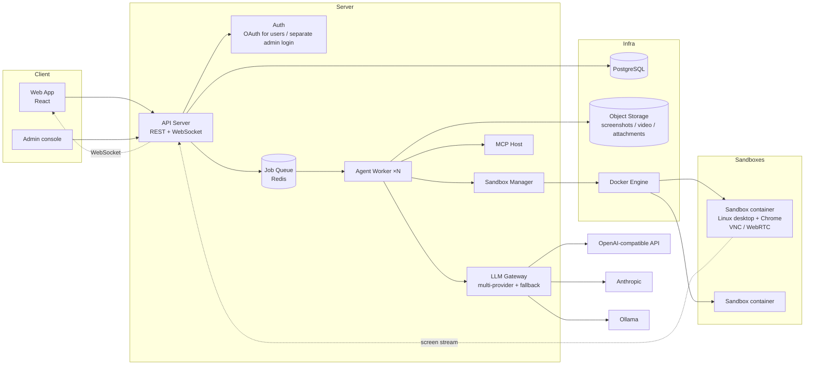

# QA Harness — Requirements and Architecture v0.4

> A web app where an LLM does QA instead of a human: manage targets under test (API, Web, Desktop) per project; the LLM generates a test list, actually operates it in a sandbox, and leaves behind evidence and verdicts.

---

## 1. Goals and scope

### 1.1 The problem
When building software with an LLM, the coding quality is already good enough, but QA is where the LLM does poorly: it doesn't know what to test, has no real environment to operate, produces untrustworthy verdicts, and leaves no evidence.

### 1.2 First version (MVP)
| Included | Not included (later versions) |
|---|---|
| Project / Target / Test List / Run management | iOS / Android emulators |
| Target kinds: Web API, Web Frontend, Desktop | CI / PR triggers |
| Sandbox: Linux desktop container (Chrome + computer use) | Notifications (email / Slack) |
| LLM auto-generates test cases | Skill marketplace / sharing |
| Live preview of the execution screen | Operational safety rails (dev-only testing) |
| Small-team sharing, two permission layers | |
| Admin console: user, LLM, sandbox settings | |
| Discussion: an MCP-enabled chat that organizes project / target descriptions | |
| Context Handoff: generate a prompt for a coding agent, import the returned doc | Reverse fail-report prompt (closed-loop bug fixing) |
| Change management: features added/removed → change proposal → update description and test list | |
| Guided discussion + auto-proposed targets | |
| During a run: phase display, findings, live test-case editing | |
| All LLM output forced through a JSON schema | |

---

## 2. Roles

### 2.1 System level
| Role | Notes |
|---|---|
| **Admin** | A separate account system; lands in the Admin console after login. Manages system settings only, and **cannot** create or join any project. |
| **User** | A regular user, working through project membership. Cannot see admin features. |

### 2.2 Project and Target level
Both layers have `owner / editor / viewer`.

| Action | viewer | editor | owner |
|---|---|---|---|
| View description, test list, run results, live screen | ✅ | ✅ | ✅ |
| Enter the discussion and talk to the LLM, edit the description | | ✅ | ✅ |
| Create / edit / delete test cases | | ✅ | ✅ |
| Trigger and abort runs | | ✅ | ✅ |
| Add / edit targets (including credentials) | | | ✅ |
| Manage members and roles | | | ✅ |
| Delete a project / target | | | ✅ |

### 2.3 Permission rules (to avoid conflicts)
1. A project member gets the **same role by default** on every target.
2. A target may **raise** a specific member's role, but **cannot lower** it below their project role.
3. The project owner is always owner of every target and cannot be overridden.
4. Only project members can be assigned a target role; a target owner cannot invite people outside the project.
5. Effective role = `max(project_role, target_role_override)`.
6. Removing a project member also deletes all of their target overrides.

---

## 3. Core concepts and data model

### 3.1 Hierarchy
```
Team
└── Project (description, references, members)
    └── QA Target (kind, config, credentials, member overrides)
        ├── Feature ×N (feature list)
        │   └── Test Case ×N
        └── Test Run ×N
            └── Test Result ×N (one per case)
```

### 3.2 Tables (overview)

**users** — id, email, name, auth_provider, status
**admins** — id, email, password_hash (fully separate from users)
**teams** — id, name
**team_members** — team_id, user_id

**projects** — id, team_id, name, description (markdown), description_version, created_by
**project_description_versions** — project_id, version, content, source (manual/discussion/handoff), created_by, created_at
**project_members** — project_id, user_id, role (owner/editor/viewer)
**project_attachments** — project_id, filename, mime, storage_key, uploaded_by (references uploaded in the discussion)
**handoff_documents** — id, scope (project/target), project_id, target_id, raw_content, parsed (jsonb), harness_version, imported_by, imported_at, applied_to_description_version

**qa_targets** — id, project_id, name, kind (api/web/desktop), config (jsonb), description, description_version, status (idle/running)
**qa_target_credentials** — target_id, key, encrypted_value (AES-GCM, key provided by KMS / env)
**qa_target_members** — target_id, user_id, role (override, only ≥ project role allowed)

**features** — id, target_id, name, description, status (active/removed), based_on_description_version
**test_cases** — id, target_id, feature_id, title, precondition, steps (jsonb), expected, priority (P0–P3), type (happy/edge/negative), source (generated/manual/change_proposal), status (active/outdated/deprecated), current_version, order
**test_case_versions** — test_case_id, version, content (jsonb), change_id, created_by, created_at
**change_proposals** — id, scope (project/target), project_id, target_id, source (discussion/handoff/manual/run_detection), status (pending/applied/rejected), description_diff, feature_changes (jsonb), test_case_changes (jsonb), created_by, created_at
**change_logs** — id, proposal_id, applied_by, applied_at, summary, description_version_after, affected_feature_ids, affected_test_case_ids
**test_runs** — id, target_id, triggered_by, status (queued/running/succeeded/failed/aborted), started_at, ended_at, sandbox_id, llm_config_snapshot (jsonb), step_count, cost_estimate
**test_results** — id, run_id, test_case_id, test_case_version, verdict (pass/fail/blocked/skipped), possibly_changed (bool), llm_reasoning, evidence (jsonb: screenshots[], video, http_logs[]), repro_steps, human_verdict (nullable), reviewed_by
**run_steps** — run_id, test_case_id, seq, phase (setup/executing/verifying/judging), action (jsonb), intent, observation, screenshot_key, model_used, duration_ms
**run_findings** — id, run_id, test_case_id (the case running when it was found), severity (critical/major/minor/info), title, description, evidence (jsonb), related_feature_id, status (open/converted_to_case/converted_to_proposal/dismissed)
**run_case_queue** — run_id, test_case_id, test_case_version (locked at run time), status (queued/running/done/skipped), order

**skills** — id, scope (global/project), project_id, name, content (markdown), enabled
**mcp_servers** — id, scope (global/project), project_id, name, url, auth (encrypted), enabled

**llm_configs** — id, name, provider (openai/anthropic/ollama/…), endpoint, api_key (encrypted), model, purposes (array: discuss/generate/execute), supports_vision, enabled
**llm_fallback_chains** — purpose, llm_config_id, order
**sandbox_settings** — image, cpu, memory, resolution, max_concurrent, max_steps_per_case, step_timeout, retention_days
**audit_logs** — actor_type (admin/user), actor_id, action, target, payload, created_at

### 3.3 Target kinds and config
| kind | config fields | credentials | executor |
|---|---|---|---|
| `api` | base_url, openapi_url / schema upload, headers | token / basic / oauth | HTTP tool, no sandbox |
| `web` | url, viewport | login credentials, test accounts | Sandbox + Chrome, computer use (CDP tool optional) |
| `desktop` | app install command or image name, launch command | depends on app | Sandbox desktop, computer use |

---

## 4. Functional spec

### 4.1 Discussion (for project / target descriptions)
- A chat interface; the LLM uses a "discuss"-purpose model.
- **Guided dialogue**: the LLM asks proactively from a "must clarify" checklist, 1–3 questions per turn, until each item is clear. The checklist depends on scope:
  - Project: product goal, user roles, main flows, modules, tech stack, dev environment, surface under test (which APIs / frontends / apps exist)
  - Target: per kind, matching the 4.2 table
- Each turn outputs (per the `discussion_turn` schema): reply message, questions, draft patch, completeness update, target proposals (may be empty)
- A right-hand "completeness" panel: each item shows unknown / partial / clear, and the user can click an item to fill it in directly
- **Auto-propose targets**: when the LLM judges the surface under test is clear, it inserts a target proposal card into the conversation (kind, name, prefilled config, credential fields to fill). The user confirms to create it, which can flow straight into the generation pipeline. The LLM does not create it directly.
- Available tools (built-in + MCP): fetch web pages, read PDF / DOCX / XLSX / MD / images, (optional) search, read a repo.
- UI requirements:
  - Drag / paste attachments; pasting a link auto-shows a preview card
  - Attachments are clearly cited in the conversation and stored in `project_attachments`
  - The right-hand "description draft" panel updates live with the conversation and is directly editable
  - One-click "save as description" → produces a new description_version
- The target discussion is the same but focused on that target's details.

### 4.2 Context Handoff (with a coding agent)
Users often can't articulate system details, but the coding agent knows them. This feature lets the two agents hand off via a document.

**Flow**
1. On the project / target page, click "generate handoff prompt" → the harness generates a prompt by scope and target kind, copyable in one click
2. The user pastes it to a coding agent (Claude Code, Cursor, etc.) and gets a returned document
3. Back in the harness, paste or upload the .md → validate the format, preview the parse
4. Choose how to apply: overwrite the description / merge into the existing description / drop into the discussion as an attachment for the LLM to organize
5. After applying, a new description_version is produced with `source=handoff`, and the original document is kept in `handoff_documents`

**Prompt content (generated by scope, not a fixed template)**
| scope | what the agent is asked to report |
|---|---|
| Project | product goal, module list, user roles, main flows, tech stack, dev environment info, known unfinished items |
| Target: api | endpoint list (method, path, params, response, error codes), auth method, how to obtain test accounts, data dependency order |
| Target: web | route table, main components and actions per page, form fields and validation rules, login flow, key selectors / data-testids |
| Target: desktop | how to launch, window structure, main operation paths |
| All scopes | a suggested test-case list (as a seed for the generation pipeline) |

**Returned document format**
- Markdown, with a YAML front-matter header: `harness_version`, `scope`, `target_kind`, `generated_at`
- Fixed section titles; the harness parses each into the matching field (endpoint list → config, test accounts → prompted to store as credentials)
- Lenient parsing: recognized sections import structured, the rest are kept as description text; a complete parse failure falls back to "as an attachment"
- The prompt includes a full format example

**Notes**
- On import, detect suspected credentials (password, token, key, etc.), prompt to store them in the encrypted field, and keep them out of the description
- The description source is marked handoff, so when a test later fails the user knows to suspect a stale handoff document
- Incremental mode (later version): attach the previous document and ask the agent to report only the differences
- Reverse handoff (later version): after QA runs, produce a "fail report prompt", paste it back to the coding agent to fix bugs, closing the loop

### 4.3 Test-case generation pipeline
```
description + target config + attachments + handoff doc (with suggested cases) + current-state exploration
   → Step 1: feature inventory → write features
   → Step 2: expand test cases per feature (precondition, steps, expected, priority, type)
   → Step 3: dedupe and sort
   → write test_cases (source=generated, bound to feature_id, recording description_version)
```
- "Current-state exploration": `api` reads the schema; `web` uses the sandbox to crawl the home page and main links for page structure.
- After generation the user can still add/remove/edit or disable individual cases.
- Handling of a description update goes through 4.4 change management, not a full pipeline re-run — only affected features are regenerated.

### 4.4 Change management
Development is dynamic; features come and go. The principle: **the LLM only proposes changes, it doesn't edit the test list directly; every change is traceable.**

**Change entry points (three, all into one flow)**
| Entry | Notes |
|---|---|
| Discussion | The user just says: "added CSV export", "removed the cart", "login switched to OTP" |
| Incremental Handoff | Generate a "here's the previous doc, report only the diff" prompt, paste it to the coding agent, then import |
| Manual description edit | Edit the description, then click "analyze impact" |
| Execution detection | See "passive detection" below |

**Change Proposal**
From the change plus the existing features / test cases, the LLM produces a structured proposal:
- Description diff
- Feature changes: add / modify / remove, with a reason
- Test-case changes: add, modify (showing a before/after diff), mark outdated, suggest deprecated, with a reason
- The user accepts / rejects / manually edits item by item, then clicks "apply"
- On apply: write a new description_version, update features / test_cases (producing new test_case_versions), write a change_log
- A proposal has no effect on existing data until applied; a proposal can be partially accepted

**Test-case status**
| Status | Meaning | Execution |
|---|---|---|
| `active` | Normal | Executed by default |
| `outdated` | The related feature or description changed, and the case hasn't been handled | Not executed by default; the UI warns "N pending" |
| `deprecated` | The feature was removed; kept for history | Not executed |

**Passive detection (infer changes from execution results)**
After a run, if a case's failure mode is "a page / component doesn't exist, an endpoint 404s, a flow entry disappeared" rather than a behavioral error, the LLM marks the result `possibly_changed` and prompts the user "this feature may have changed — create a change proposal?" → straight into the proposal flow. This catches cases the user forgot to mention.

**Change Log**
The project and target each have a timeline: time, actor, entry point, summary, and the number of affected features and test cases. From any test case you can trace the change behind each of its versions.

**Notes**
- A modify-type change must show a diff, not just the new version
- Only affected features have their test cases regenerated, avoiding a full re-run on every change
- A proposal can't be applied while a target is running (consistent with the running-is-read-only rule); it can be created and applied after the run ends

### 4.5 Execution
- Trigger: editor or above, choose all or selected cases; by default only `active` cases run.
- **Only one run per target at a time**: backend `qa_targets.status` + a DB lock; the frontend disables the button during a run and shows who's running and the progress. No queueing, no takeover.
- Different targets can run in parallel, capped by `sandbox_settings.max_concurrent`; excess goes to a queue.
- Run flow:
  1. Into the job queue → a worker picks it up
  2. Start a sandbox (skipped for api)
  3. Load skills (global + project), MCP, target credentials
  4. Run the agent loop per case: read the latest version and lock it into `run_case_queue` before the case starts; record each step to `run_steps` per the `execution_step` schema
  5. Each case produces a `case_verdict` (verdict, reasoning, evidence, repro_steps required on fail, possibly_changed)
  6. Issues unrelated to the case found during the run are recorded as `finding` (not mixed into the verdict)
  7. Reclaim the sandbox, write the results
- Guards: a per-case step cap, timeout, and total-run timeout; exceeding them is marked `blocked`.
- **Locking rules during a run (by case status)**:

| The case's status in this run | Editable | Effect |
|---|---|---|
| queued | ✅ | This run uses the new version |
| running | ❌ | — |
| done / skipped | ✅ | Next run; this result is flagged "case edited after use" |

  - During a run you can: add a case to the end of this run, skip a queued case
  - Still locked during a run: the target description, config, credentials, and applying a change proposal

### 4.6 Live run page
- Left: the sandbox live screen (all authorized viewers share one stream)
- Top right: three levels of progress — Run (case N / M), Case (setup → executing → verifying → judging), Step (current action + intent)
- Middle right: the case list, showing queued / running / done and the live verdict; a queued case can be opened and edited directly
- Bottom right: a live finding list (severity, title, screenshot), shown the moment the LLM finds one
- Actions: abort, skip a case, add a case, edit a queued case (editor or above)

### 4.7 Results page
- Run overview: pass / fail / blocked counts, duration, step count, models used (including fallback switches)
- Per case: verdict, LLM reasoning, screenshot timeline, recording, HTTP log, repro steps
- Human review: mark a `human_verdict` (agree / overrule), shown separately from the LLM verdict
- A `possibly_changed` case shows a "create change proposal" entry
- Finding list: convert to a test case or change proposal in one click, or dismiss
- View pass rate by feature
- Re-run failed cases in one click

### 4.8 Admin console
- **Users**: invite, disable, view team / project membership
- **LLM Providers**
  - Add a config: provider, endpoint, key, model, purposes (multi-select), whether it supports vision
  - Send a test prompt right in the browser, showing the response and latency
  - One fallback chain per purpose, drag to reorder
  - Save validation: at least one config per purpose; the `execute` purpose must be supports_vision
  - Fallback triggers: timeout, rate limit, 5xx, malformed output
- **Sandbox**
  - Container image, CPU / memory, resolution, concurrency cap, step cap, timeout, evidence retention days
  - A "start test sandbox" button: spin up a container and preview it live to confirm the environment is healthy
- **Skills / MCP (global)**
- **Usage and audit**: runs, steps, and estimated cost per project; the audit log

### 4.9 LLM Output Contract
Every feature's stability rests on this section. The principle: **every kind of LLM interaction has a fixed JSON schema, forced via structured output / tool calling; the backend validates, retries on failure, and only falls back to the next model when retries still fail. Free text may only appear in schema-designated fields.**

| schema | purpose | main fields |
|---|---|---|
| `discussion_turn` | each discussion turn | message, questions[], draft_patch, completeness{item: unknown/partial/clear}, target_proposals[] |
| `feature_list` | generation pipeline step 1 | features[]{name, description} |
| `test_case` | generation pipeline step 2 | feature_ref, title, precondition, steps[], expected, priority, type |
| `change_proposal` | change management | description_diff, feature_changes[], test_case_changes[]{op, case_id, before, after, reason} |
| `execution_step` | each execution step | phase, action{type, params}, intent, observation |
| `case_verdict` | end of each case | verdict, reasoning, evidence_refs[], repro_steps[] (required on fail), possibly_changed |
| `finding` | new finding during a run | severity, title, description, evidence_refs[], related_feature_ref |
| `handoff_document` | handoff document | front-matter + fixed sections |

- Every schema carries a `schema_version`, stored in a single source in the repo (e.g. `/schemas/*.json`); the prompt includes the schema, and the frontend renders from it
- On validation failure: log the raw output, retry up to N times (with the validation errors so the LLM can fix it), then trigger fallback; if all fail, the case is marked `blocked` with a reason
- Providers without structured output (some Ollama models): ask for pure JSON via prompt + lenient server-side parsing (strip code fences) + validation; same retry and fallback

---

## 5. System architecture



### 5.1 Components
| Component | Responsibility |
|---|---|
| **API Server** | REST (CRUD, permissions), WebSocket (run status, screen-stream relay, discussion streaming) |
| **Auth** | Users via OAuth (Google / GitHub); admins have a separate table, login page, and session |
| **Job Queue** | run queueing, worker dispatch, concurrency cap |
| **Agent Worker** | runs the agent loop: assemble the prompt (description + skills + case), call the LLM, execute tools, record steps |
| **LLM Gateway** | unify provider interfaces, pick the fallback chain by purpose, record the model actually used and usage |
| **MCP Host** | manage global / project MCP server connections and expose tools to workers and the discussion |
| **Sandbox Manager** | start/stop containers via the Docker API, allocate ports, health check, reclaim on timeout, stream the screen |
| **Sandbox container** | Ubuntu + Xvfb + a lightweight WM + Chrome + a VNC server (noVNC / WebRTC relay) + a computer-use agent (screenshot / click / type / scroll) + optional Playwright / CDP |
| **Object Storage** | S3-compatible (self-hosted MinIO), cleaned up per retention_days |

### 5.2 Suggested technology choices
| Layer | Suggestion | Reason |
|---|---|---|
| Frontend | React + TypeScript + Tailwind | mature ecosystem, familiar to LLMs |
| Backend | Node.js (NestJS / Hono) or Python (FastAPI) | pick what the team knows; Python's LLM / MCP SDKs are a bit more mature |
| DB | PostgreSQL (jsonb for config / steps) | one DB covers it |
| Queue | Redis + BullMQ (Node) or RQ / Celery (Python) | simple and sufficient |
| Screen stream | noVNC (v1) → WebRTC (when latency matters) | noVNC is the fastest to get working |
| Sandbox | Docker, one container per run; can borrow Anthropic's computer-use-demo image | a ready-made base exists |
| Credential encryption | AES-256-GCM, master key via env / KMS | |
| Deployment | docker compose (app, db, redis, minio, docker socket mounted) | self-hosted for a small team |

### 5.3 Key design decisions
| Decision | Choice | Reason |
|---|---|---|
| Admin vs User | fully separate accounts | avoid permission confusion; admin doesn't touch business data |
| Same-target concurrency | lock it out, don't queue | simple, no race conditions |
| Test-case source | LLM-generated, human-editable | user need; keep it editable to avoid losing control |
| LLM config | by purpose, one config can select multiple purposes | discuss / generate / execute have different model needs |
| Sandbox form | a unified Linux desktop container | browser is a subset of computer use; adding Android later is natural |
| Result trustworthiness | LLM verdict + evidence + a human_verdict field | LLM verdicts can't be fully trusted and must be reviewable |
| Test environment | dev only | v1 has no operational safety rails |

---

## 6. Risks and caveats
1. **Computer-use cost**: one vision call per step, and a case can be 30–100 steps. A step cap and usage tracking are required features, not nice-to-haves.
2. **Ollama for computer use**: few local models can reliably do GUI operation. The `execute` fallback should prefer a cloud vision model, with local models as the last resort and expected to degrade.
3. **LLM false positives**: an untrustworthy pass is the main failure mode of this kind of system. Force evidence, force repro_steps on fail, and encourage human spot-checks.
4. **Sandbox resources**: a desktop container is ~1–2 GB RAM; align the concurrency cap with the host's specs.
5. **Credential exposure surface**: credentials go into prompts for the LLM to use; use dedicated dev-environment test accounts, not real accounts.

---

## 7. Suggested build order
1. Auth + Team / Project / Target CRUD + permission rules (with tests)
2. Admin console: LLM provider config + test + fallback; LLM Gateway
3. Output Contract: define all schemas + the LLM Gateway's validation / retry / fallback
4. Discussion (guided dialogue + completeness panel + target proposals; text and URLs first, then file formats) + Context Handoff
5. Test-case generation pipeline (api kind first) + feature structure
6. Change management: discussion entry + Change Proposal + status and versions
7. Sandbox Manager + container image + noVNC stream
8. Agent Worker + web-kind execution + live run page (progress, findings, live editing)
9. Results page + human review + passive detection + finding conversion
10. desktop kind, skills / MCP management, usage tracking, incremental Handoff
