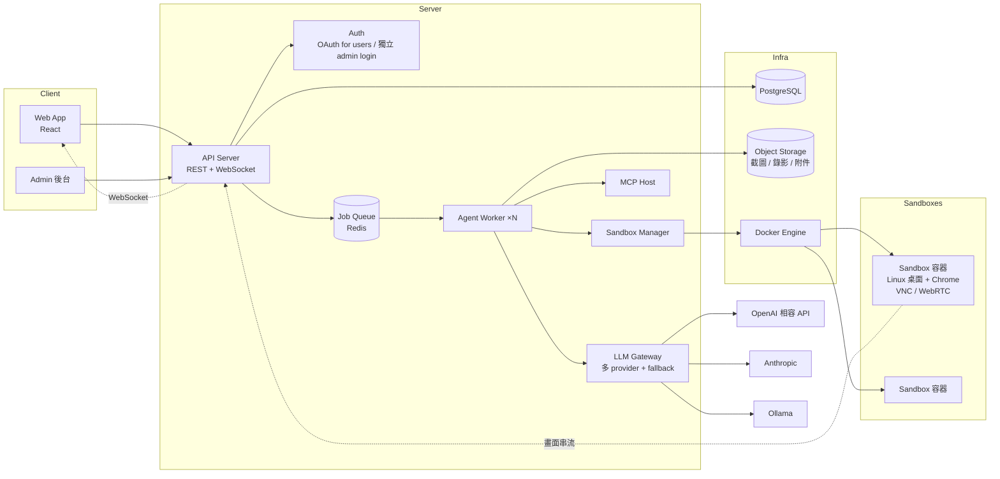

# QA Harness — 需求與架構文件 v0.4

> 一個讓 LLM 代替人做 QA 的 web app：以 Project 為單位管理被測目標（API、Web、Desktop），由 LLM 生成測試清單、在 sandbox 中實際操作、留下證據與判定。

---

## 1. 目標與範圍

### 1.1 要解決的問題
用 LLM 開發專案時，寫程式的品質已經夠好，但 QA 環節 LLM 做不好：不知道要測什麼、沒有真實環境可操作、判定結果不可信、沒有留下證據。

### 1.2 第一版範圍（MVP）
| 包含 | 不包含（後續版本） |
|---|---|
| Project / Target / Test List / Run 管理 | iOS / Android 模擬器 |
| Target 種類：Web API、Web Frontend、Desktop | CI / PR 觸發 |
| Sandbox：Linux 桌面容器（Chrome + computer use） | 通知（email / Slack） |
| LLM 自動生成 test case | Skill 市集 / 分享 |
| 即時預覽執行畫面 | 操作安全限制（只測 dev 環境） |
| 小團隊多人共用、兩層權限 | |
| Admin 後台：user、LLM、sandbox 設定 | |
| 討論區：帶 MCP 的 chat，整理 project / target 描述 | |
| Context Handoff：產生 prompt 給 coding agent，匯入回傳文件 | 反向 fail 報告 prompt（閉環修 bug） |
| 變更管理：功能增減 → 變更提案 → 更新描述與 test list | |
| 引導式討論 + 自動提案 Target | |
| 執行中：階段顯示、Finding、即時編輯 test case | |
| 所有 LLM 輸出強制 JSON schema | |

---

## 2. 角色

### 2.1 系統層
| 角色 | 說明 |
|---|---|
| **Admin** | 獨立帳號體系，登入後進入 Admin 後台。只管系統設定，**不能**建立或參與任何 Project。 |
| **User** | 一般使用者，透過 Project 成員身份工作。看不到 Admin 功能。 |

### 2.2 Project 層與 Target 層
兩層各有 `owner / editor / viewer`。

| 動作 | viewer | editor | owner |
|---|---|---|---|
| 看描述、test list、run 結果、即時畫面 | ✅ | ✅ | ✅ |
| 進討論區與 LLM 對談、修改描述 | | ✅ | ✅ |
| 建立 / 修改 / 刪除 test case | | ✅ | ✅ |
| 觸發執行、中止執行 | | ✅ | ✅ |
| 新增 / 修改 Target（含憑證） | | | ✅ |
| 管理成員與角色 | | | ✅ |
| 刪除 Project / Target | | | ✅ |

### 2.3 權限規則（避免衝突）
1. Project 成員在所有 Target 上**預設**取得與 Project 相同的角色。
2. Target 層可以**提升**特定成員的角色，**不能降低**至低於其 Project 角色。
3. Project owner 永遠是所有 Target 的 owner，不可被覆蓋。
4. 只有 Project 成員可以被指派 Target 角色；Target owner 不能邀請 Project 外的人。
5. 有效角色 = `max(project_role, target_role_override)`。
6. 移出 Project 成員時，其所有 Target override 一併刪除。

---

## 3. 核心概念與資料模型

### 3.1 階層
```
Team
└── Project（描述、參考資料、成員）
    └── QA Target（種類、設定、憑證、成員 override）
        ├── Feature ×N（功能清單）
        │   └── Test Case ×N
        └── Test Run ×N
            └── Test Result ×N（每條 case 一筆）
```

### 3.2 資料表（概要）

**users** — id, email, name, auth_provider, status
**admins** — id, email, password_hash（與 users 完全分離）
**teams** — id, name
**team_members** — team_id, user_id

**projects** — id, team_id, name, description (markdown), description_version, created_by
**project_description_versions** — project_id, version, content, source (manual/discussion/handoff), created_by, created_at
**project_members** — project_id, user_id, role (owner/editor/viewer)
**project_attachments** — project_id, filename, mime, storage_key, uploaded_by（討論區上傳的參考資料）
**handoff_documents** — id, scope (project/target), project_id, target_id, raw_content, parsed (jsonb), harness_version, imported_by, imported_at, applied_to_description_version

**qa_targets** — id, project_id, name, kind (api/web/desktop), config (jsonb), description, description_version, status (idle/running)
**qa_target_credentials** — target_id, key, encrypted_value（AES-GCM，key 由 KMS / env 提供）
**qa_target_members** — target_id, user_id, role（override，只允許 ≥ project role）

**features** — id, target_id, name, description, status (active/removed), based_on_description_version
**test_cases** — id, target_id, feature_id, title, precondition, steps (jsonb), expected, priority (P0–P3), type (happy/edge/negative), source (generated/manual/change_proposal), status (active/outdated/deprecated), current_version, order
**test_case_versions** — test_case_id, version, content (jsonb), change_id, created_by, created_at
**change_proposals** — id, scope (project/target), project_id, target_id, source (discussion/handoff/manual/run_detection), status (pending/applied/rejected), description_diff, feature_changes (jsonb), test_case_changes (jsonb), created_by, created_at
**change_logs** — id, proposal_id, applied_by, applied_at, summary, description_version_after, affected_feature_ids, affected_test_case_ids
**test_runs** — id, target_id, triggered_by, status (queued/running/succeeded/failed/aborted), started_at, ended_at, sandbox_id, llm_config_snapshot (jsonb), step_count, cost_estimate
**test_results** — id, run_id, test_case_id, test_case_version, verdict (pass/fail/blocked/skipped), possibly_changed (bool), llm_reasoning, evidence (jsonb: screenshots[], video, http_logs[]), repro_steps, human_verdict (nullable), reviewed_by
**run_steps** — run_id, test_case_id, seq, phase (setup/executing/verifying/judging), action (jsonb), intent, observation, screenshot_key, model_used, duration_ms
**run_findings** — id, run_id, test_case_id (發現時正在跑的 case), severity (critical/major/minor/info), title, description, evidence (jsonb), related_feature_id, status (open/converted_to_case/converted_to_proposal/dismissed)
**run_case_queue** — run_id, test_case_id, test_case_version (執行時鎖定), status (queued/running/done/skipped), order

**skills** — id, scope (global/project), project_id, name, content (markdown), enabled
**mcp_servers** — id, scope (global/project), project_id, name, url, auth (encrypted), enabled

**llm_configs** — id, name, provider (openai/anthropic/ollama/…), endpoint, api_key (encrypted), model, purposes (array: discuss/generate/execute), supports_vision, enabled
**llm_fallback_chains** — purpose, llm_config_id, order
**sandbox_settings** — image, cpu, memory, resolution, max_concurrent, max_steps_per_case, step_timeout, retention_days
**audit_logs** — actor_type (admin/user), actor_id, action, target, payload, created_at

### 3.3 Target 種類與 config
| kind | config 欄位 | 憑證 | 執行器 |
|---|---|---|---|
| `api` | base_url, openapi_url / schema 上傳, headers | token / basic / oauth | HTTP tool，不起 sandbox |
| `web` | url, viewport | 登入帳密、測試帳號 | Sandbox + Chrome，computer use（可加 CDP 工具） |
| `desktop` | app 安裝指令或 image 名稱、啟動命令 | 視 app | Sandbox 桌面，computer use |

---

## 4. 功能規格

### 4.1 討論區（Project / Target 描述用）
- Chat 介面，LLM 使用「discuss」用途的 model。
- **引導式對談**：LLM 帶著「必須釐清的項目清單」主動提問，每輪 1–3 個問題，直到各項目清楚為止。清單依 scope 而異：
  - Project：產品目標、使用者角色、主要流程、模組、技術棧、dev 環境、被測面（有哪些 API / 前端 / app）
  - Target：依 kind 對應 4.2 表格的內容
- 每輪輸出（依 `discussion_turn` schema）：回覆訊息、問題、草稿 patch、完整度更新、Target 提案（可空）
- UI 右側「完整度」面板：每個項目顯示 未知 / 部分 / 清楚，使用者可點某項直接補充
- **自動提案 Target**：LLM 判斷被測面已清楚時，在對話中插入 Target 提案卡（kind、名稱、預填 config、待填憑證欄位）。使用者確認後建立，可直接接生成 pipeline。LLM 不直接建立。
- 可用工具（內建 + MCP）：抓網頁、讀 PDF / DOCX / XLSX / MD / 圖片、（可選）搜尋、讀 repo。
- UI 要求：
  - 拖曳 / 貼上附件，貼連結自動顯示預覽卡
  - 附件在對話中有明確引用標示，並存到 `project_attachments`
  - 右側「描述草稿」面板隨對話即時更新，使用者可直接編輯
  - 一鍵「儲存為描述」→ 產生新 description_version
- Target 討論區同理，但焦點在該 Target 的細節。

### 4.2 Context Handoff（與 coding agent 交接）
使用者往往說不清系統細節，但寫程式的 coding agent 知道。此功能讓兩個 agent 用文件交接。

**流程**
1. Project / Target 頁面按「產生交接 prompt」→ harness 依 scope 與 target kind 生成 prompt，一鍵複製
2. 使用者貼給 coding agent（Claude Code、Cursor 等），取得回傳文件
3. 回到 harness 貼上或上傳 .md → 驗證格式、預覽解析結果
4. 選擇套用方式：覆蓋描述 / 合併進現有描述 / 丟進討論區當附件讓 LLM 整理
5. 套用後產生新 description_version，`source=handoff`，並保存原始文件於 `handoff_documents`

**Prompt 內容（依 scope 生成，非固定模板）**
| scope | 要求 agent 回報的內容 |
|---|---|
| Project | 產品目標、模組清單、使用者角色、主要流程、技術棧、dev 環境資訊、已知未完成項目 |
| Target: api | endpoint 清單（方法、路徑、參數、回應、錯誤碼）、認證方式、測試帳號取得方式、資料相依順序 |
| Target: web | 路由表、各頁主要元件與操作、表單欄位與驗證規則、登入流程、關鍵 selector / data-testid |
| Target: desktop | 啟動方式、視窗結構、主要操作路徑 |
| 所有 scope | 建議的 test case 清單（作為生成 pipeline 的種子） |

**回傳文件格式**
- Markdown，檔頭為 YAML front-matter：`harness_version`、`scope`、`target_kind`、`generated_at`
- 固定 section 標題，harness 依標題解析到對應欄位（endpoint 清單 → config、測試帳號 → 提示存入憑證）
- 解析採寬鬆策略：認得的 section 結構化匯入，其餘保留為描述文字；完全解析失敗則退回「當附件」
- Prompt 內附完整格式範例

**注意**
- 匯入時偵測疑似憑證（password、token、key 等），提示改存加密欄位，不留在描述中
- 描述來源標記為 handoff，後續 test fail 時使用者知道應懷疑交接文件是否過時
- 增量模式（後續版本）：附上上次文件，要 agent 只回報差異
- 反向交接（後續版本）：QA 跑完後產生「fail 報告 prompt」，貼回 coding agent 修 bug，形成閉環

### 4.3 Test Case 生成 pipeline
```
描述 + Target config + 附件 + handoff 文件（含建議 test case）+ 現況探索
   → Step 1: 功能清單（feature inventory）→ 寫入 features
   → Step 2: 每個 feature 展開 test case（含前置、步驟、預期、優先級、類型）
   → Step 3: 去重與排序
   → 寫入 test_cases（source=generated，綁 feature_id，記錄 description_version）
```
- 「現況探索」：api 讀 schema；web 用 sandbox 爬首頁與主要連結取得頁面結構。
- 生成後使用者仍可增刪改、停用單條 case。
- 描述更新後的處理走 4.4 變更管理，不重跑整個 pipeline，只針對受影響的 feature 重生成。

### 4.4 變更管理（Change Management）
開發是動態的，功能會增減。原則：**LLM 只提出變更提案，不直接改 test list；所有變更可追溯。**

**變更入口（三種，統一進同一流程）**
| 入口 | 說明 |
|---|---|
| 討論區 | 使用者直接講：「加了匯出 CSV」「購物車移除了」「登入改成 OTP」 |
| 增量 Handoff | 產生「附上上次文件 + 只回報差異」的 prompt，貼給 coding agent 後匯入 |
| 手動改描述 | 編輯描述後按「分析影響」 |
| 執行結果偵測 | 見下方「被動偵測」 |

**Change Proposal（變更提案）**
LLM 依變更內容 + 現有 features / test cases 產出結構化提案：
- 描述 diff
- Feature 變動：新增 / 修改 / 移除，附理由
- Test case 變動：新增、修改（顯示前後 diff）、標記 outdated、建議 deprecated，附理由
- 使用者逐項接受 / 拒絕 / 手動修改後按「套用」
- 套用時：寫入新 description_version、更新 features / test_cases（產生新 test_case_version）、寫 change_log
- 提案未套用前對現有資料無影響；提案可以部分接受

**Test case 狀態**
| 狀態 | 意義 | 執行 |
|---|---|---|
| `active` | 正常 | 預設執行 |
| `outdated` | 相關 feature 或描述已變更，case 尚未處理 | 預設不執行，UI 提醒「N 條待處理」 |
| `deprecated` | 功能已移除，保留歷史 | 不執行 |

**被動偵測（從執行結果反推變更）**
Run 結束後，若 case 的失敗模式是「頁面 / 元件不存在、endpoint 404、流程入口消失」而非行為錯誤，LLM 將 result 標記 `possibly_changed`，並提示使用者「此功能可能已變更，是否建立變更提案？」→ 直接進入提案流程。用來補使用者忘記告知的情況。

**Change Log**
Project 與 Target 各有時間軸：時間、操作者、入口、摘要、影響的 feature 與 test case 數。可從任一 test case 回溯其每個版本對應的變更。

**注意**
- 修改型變動必須顯示 diff，不只給新版本
- 只針對受影響 feature 重生成 test case，避免每次變更都全部重跑
- Target 執行中不可套用提案（與執行中唯讀規則一致），提案可先建立待執行結束後套用

### 4.5 執行
- 觸發：editor 以上，可選全部或勾選 case；預設只跑 `active` 狀態的 case。
- **同一 Target 同時只允許一個 run**：後端 `qa_targets.status` + DB lock；前端執行中時按鈕停用，顯示誰在跑、進度。不排隊、不接手。
- 不同 Target 可並行，受 `sandbox_settings.max_concurrent` 限制，超過則進 queue。
- Run 流程：
  1. 進 job queue → worker 領取
  2. 起 sandbox（api 類型跳過）
  3. 載入 skills（global + project）、MCP、Target 憑證
  4. 逐條 case 執行 agent loop：case 開始前讀取最新版本並鎖定於 `run_case_queue`；每步依 `execution_step` schema 記 `run_steps`
  5. 每條 case 產出 `case_verdict`（verdict、reasoning、evidence、repro_steps fail 必填、possibly_changed）
  6. 執行過程中與 case 無關的問題記為 `finding`（不混進 verdict）
  7. 回收 sandbox，寫入結果
- 保護：每條 case 步數上限、逾時、總 run 逾時；超過標為 `blocked`。
- **執行中的鎖定規則（按 case 狀態）**：

| case 在此 run 的狀態 | 可否編輯 | 生效 |
|---|---|---|
| queued | ✅ | 本次 run 使用新版本 |
| running | ❌ | — |
| done / skipped | ✅ | 下次 run；本次結果標記「case 已於執行後修改」 |

  - 執行中可：新增 case 到本次 run 尾端、跳過 queued 的 case
  - 執行中仍鎖住：Target 描述、config、憑證、變更提案套用

### 4.6 執行中頁面
- 左：sandbox 即時畫面（所有有權限者共享同一串流）
- 右上：三層進度 — Run（第 N / M 條）、Case（setup → executing → verifying → judging）、Step（目前動作 + 意圖）
- 右中：case 清單，顯示 queued / running / done 與即時 verdict；queued 的 case 可直接點開編輯
- 右下：Finding 即時列表（嚴重度、標題、截圖），LLM 一發現就顯示
- 操作：中止、跳過 case、新增 case、編輯 queued case（editor 以上）

### 4.7 結果頁
- Run 總覽：pass / fail / blocked 數、耗時、步數、使用的 model（含 fallback 切換紀錄）
- 每條 case：verdict、LLM 理由、截圖時間軸、錄影、HTTP log、重現步驟
- 人工覆核：可標記 `human_verdict`（同意 / 推翻），與 LLM verdict 分開顯示
- 標記 `possibly_changed` 的 case 顯示「建立變更提案」入口
- Finding 清單：可一鍵轉成 test case 或變更提案，或標記忽略
- 按 feature 檢視通過率
- 一鍵重跑失敗的 case

### 4.8 Admin 後台
- **Users**：邀請、停用、查看所屬 team / project
- **LLM Providers**
  - 新增設定：provider、endpoint、key、model、用途（多選）、是否支援 vision
  - 網頁上直接送測試 prompt，顯示回應與延遲
  - 每個用途一條 fallback chain，可拖曳排序
  - 儲存驗證：每個用途至少一組；`execute` 用途必須 supports_vision
  - Fallback 觸發條件：timeout、rate limit、5xx、回傳格式錯誤
- **Sandbox**
  - 容器 image、CPU / memory、解析度、並行上限、步數上限、逾時、證據保留天數
  - 「起測試 sandbox」按鈕：起一個容器並即時預覽，確認環境正常
- **Skills / MCP（global）**
- **用量與稽核**：各 project 的 run 數、步數、估算成本；audit log

### 4.9 LLM 輸出規範（Output Contract）
所有功能的穩定性都依賴這一節。原則：**每一種 LLM 互動都有固定 JSON schema，用 structured output / tool calling 強制；後端驗證，失敗重試，重試仍失敗才 fallback 到下一個 model。自由文字只能出現在 schema 指定欄位。**

| schema | 用途 | 主要欄位 |
|---|---|---|
| `discussion_turn` | 討論區每輪 | message, questions[], draft_patch, completeness{item: unknown/partial/clear}, target_proposals[] |
| `feature_list` | 生成 pipeline step 1 | features[]{name, description} |
| `test_case` | 生成 pipeline step 2 | feature_ref, title, precondition, steps[], expected, priority, type |
| `change_proposal` | 變更管理 | description_diff, feature_changes[], test_case_changes[]{op, case_id, before, after, reason} |
| `execution_step` | 執行每步 | phase, action{type, params}, intent, observation |
| `case_verdict` | 每條 case 結束 | verdict, reasoning, evidence_refs[], repro_steps[]（fail 必填）, possibly_changed |
| `finding` | 執行中新發現 | severity, title, description, evidence_refs[], related_feature_ref |
| `handoff_document` | 交接文件 | front-matter + 固定 section |

- 所有 schema 帶 `schema_version`，存於 repo 單一來源（如 `/schemas/*.json`），prompt 附上 schema，前端依 schema 渲染
- 驗證失敗：記錄原始輸出、重試最多 N 次（附上驗證錯誤讓 LLM 修正）、再失敗觸發 fallback；全部失敗則該 case 標 `blocked` 並附原因
- 不支援 structured output 的 provider（部分 Ollama 模型）：用 prompt 要求純 JSON + 後端寬鬆解析（去 code fence）+ 驗證；同樣走重試與 fallback

---

## 5. 系統架構



### 5.1 元件說明
| 元件 | 職責 |
|---|---|
| **API Server** | REST（CRUD、權限）、WebSocket（run 狀態、畫面串流轉發、討論區 streaming） |
| **Auth** | Users 走 OAuth（Google / GitHub）；Admins 獨立表、獨立登入頁、獨立 session |
| **Job Queue** | run 排隊、worker 分派、並行上限控制 |
| **Agent Worker** | 跑 agent loop：組 prompt（描述 + skills + case）、呼叫 LLM、執行 tool、記錄 step |
| **LLM Gateway** | 統一各 provider 介面、依用途取 fallback chain、記錄實際使用 model 與用量 |
| **MCP Host** | 管理 global / project MCP server 連線，把 tool 暴露給 worker 與討論區 |
| **Sandbox Manager** | 透過 Docker API 起停容器、分配 port、健康檢查、逾時回收、串流畫面 |
| **Sandbox 容器** | Ubuntu + Xvfb + 輕量 WM + Chrome + VNC server（noVNC / WebRTC 轉發）+ computer use agent（screenshot / click / type / scroll）+ 可選 Playwright / CDP |
| **Object Storage** | S3 相容（MinIO 自架），依 retention_days 清理 |

### 5.2 技術選型建議
| 層 | 建議 | 理由 |
|---|---|---|
| 前端 | React + TypeScript + Tailwind | 生態成熟、LLM 熟 |
| 後端 | Node.js（NestJS / Hono）或 Python（FastAPI） | 選 team 熟的；Python 的 LLM / MCP SDK 略成熟 |
| DB | PostgreSQL（jsonb 存 config / steps） | 一個 DB 解決 |
| Queue | Redis + BullMQ（Node）或 RQ / Celery（Python） | 簡單夠用 |
| 畫面串流 | noVNC（第一版）→ WebRTC（延遲要求高時） | noVNC 最快能動 |
| Sandbox | Docker，每 run 一容器；可參考 Anthropic computer-use-demo 的 image | 已有現成基礎 |
| 憑證加密 | AES-256-GCM，master key 走 env / KMS | |
| 部署 | docker compose（app、db、redis、minio、docker socket 掛載） | 小團隊自架 |

### 5.3 關鍵設計決策紀錄
| 決策 | 選擇 | 原因 |
|---|---|---|
| Admin 與 User | 完全分離帳號 | 避免權限混淆，admin 不碰業務資料 |
| 同 Target 併發 | 鎖住不給跑，不排隊 | 簡單、無 race condition |
| Test case 來源 | LLM 自動生成，人可改 | 使用者需求；保留可編輯避免完全失控 |
| LLM 設定 | 依用途，一組設定可多選用途 | 討論 / 生成 / 執行對模型需求不同 |
| Sandbox 形態 | 統一 Linux 桌面容器 | browser 是 computer use 子集；未來加 Android 順路 |
| 結果可信度 | LLM verdict + 證據 + human_verdict 欄位 | LLM 判定不可盡信，必須可覆核 |
| 測試環境 | 只測 dev | 第一版不做操作安全限制 |

---

## 6. 風險與注意事項
1. **Computer use 成本**：每步一次 vision call，一條 case 可能 30–100 步。步數上限與用量統計是必要功能，不是 nice-to-have。
2. **Ollama 跑 computer use**：本地模型能穩定做 GUI 操作的很少。`execute` 用途的 fallback 應優先雲端 vision model，本地模型當最後備援並預期降級。
3. **LLM 判定假陽性**：pass 不可信是這類系統的主要失敗模式。強制 evidence、fail 時強制 repro_steps、鼓勵人工抽查。
4. **Sandbox 資源**：一個桌面容器約 1–2 GB RAM；並行上限要跟主機規格對齊。
5. **憑證洩漏面**：憑證會進 prompt 給 LLM 使用；用 dev 環境的專用測試帳號，不要用真帳號。

---

## 7. 開發順序建議
1. Auth + Team / Project / Target CRUD + 權限規則（含測試）
2. Admin 後台：LLM provider 設定 + 測試 + fallback；LLM Gateway
3. Output Contract：定義所有 schema + LLM Gateway 的驗證 / 重試 / fallback
4. 討論區（引導式對談 + 完整度面板 + Target 提案；先文字與 URL，再加檔案格式）+ Context Handoff
5. Test case 生成 pipeline（先 api 類型）+ features 結構
6. 變更管理：討論區入口 + Change Proposal + 狀態與版本
7. Sandbox Manager + 容器 image + noVNC 串流
8. Agent Worker + web 類型執行 + 執行中頁面（進度、Finding、即時編輯）
9. 結果頁 + 人工覆核 + 被動偵測 + Finding 轉換
10. desktop 類型、skills / MCP 管理、用量統計、增量 Handoff
